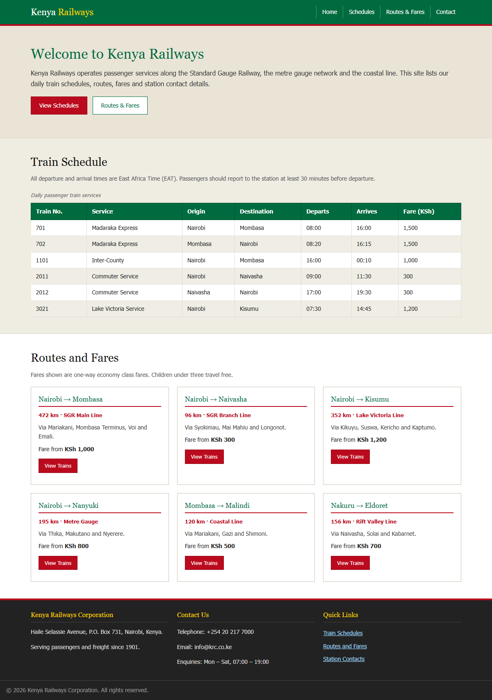
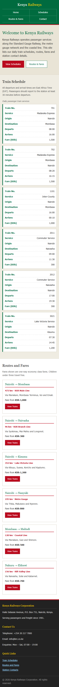

# Kenya Railways + SAC workspace

Public repository containing two student projects.

## 1. Kenya Railways website (`railway/`)

A static, mobile-first website for Kenya Railways: train schedules, routes and
fares, and contact details.

- `railway/index.html` — single-page site with `Welcome`, `Train Schedule`,
  `Routes and Fares` and `Contact` sections.
- `railway/style.css` — mobile-first stylesheet (base for small phones,
  enhancements at `600px` and `900px`) demonstrating element, class, ID and
  pseudo-element selectors, Flexbox navigation, a CSS Grid route layout and a
  responsive schedule table.
- `railway/serve.js` — tiny Node static file server (no dependencies).
- `railway/cdp-shot.js` — screenshot helper that drives headless Chrome over the
  DevTools protocol.
- `railway/screenshots/` — rendered desktop (1200px) and mobile (375px) captures.

### Run locally

```bash
cd railway
node serve.js        # http://127.0.0.1:8123
```

### Screenshots

| Desktop | Mobile |
| --- | --- |
|  |  |

## 2. Smart Academic Companion (`week/sac/`)

A Spring Boot (Maven) application. See [week/sac/README.md](week/sac/README.md).

```bash
cd week/sac
./run.sh
```

Supporting material lives in `week/` (project proposal and `sac.zip`).
